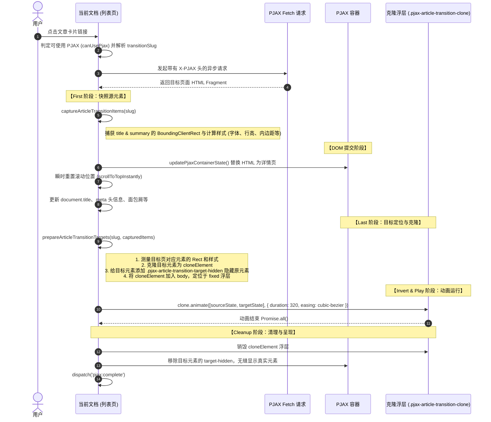

# WindBlog PJAX 与文章进入过渡动画机制指南

WindBlog 采用自研轻量级 PJAX 结合原生 Web Animations API (WAAPI) 实现顺滑的无刷新页面切换，并在**列表/卡片跳转到文章详情页**（以及从详情页返回）时应用了基于 **FLIP 原则的共享元素（Shared Element）过渡动画**。

---

## 1. 核心架构与设计思想

1. **为什么不用原生 View Transitions API？**
   在代码注记与实践中，原生 View Transition 在涉及不同版面排版时，其快照（screenshots）在跨布局文本缩放（字体大小、行高、文字折行）重绘表现上不够平滑（易失真或裁切）。因此 WindBlog 采用了 **手动 FLIP (First, Last, Invert, Play) 动画机制**，精准对文章标题 (`title`) 与摘要 (`summary`) 的尺寸、绝对视口位置及排版样式进行平滑插值。

2. **渐进增强与降级保障：**
   - 若命中系统偏好 `prefers-reduced-motion: reduce`，动画自动跳过。
   - 若目标页没有对应的 transition slug 或目标元素丢失，自动平滑回退到 PJAX 整体容器淡入动画（`opacity: 0.65 -> 1`，耗时 180ms）。
   - 动画逻辑封装在 `try...catch` 中，**动画异常永远不会中断主流程的 PJAX DOM 渲染与路由切换**。

---

## 2. 动画触发与匹配机制

### 2.1 HTML 标记规范 (Qute 模板)
在模板中，文章卡片与文章详情页通过特定的 `data-*` 属性进行配对：
- `data-article-transition-slug="{post.slug}"`：标识目标文章唯一 slug。
- `data-article-transition-part="title"`：标识文章标题部分。
- `data-article-transition-part="summary"`：标识文章摘要部分（可选）。

**代码位置：**
- 列表/分类/标签/搜索模板：
  - `src/main/resources/templates/blog/index.content.html`
  - `src/main/resources/templates/blog/category.content.html`
  - `src/main/resources/templates/blog/tag.content.html`
  - `src/main/resources/templates/blog/search.content.html`
- 文章详情模板：
  - `src/main/resources/templates/blog/post.content.html`
  - `src/main/resources/templates/blog/post.vditor.content.html`

### 2.2 Slug 解析 (`resolveArticleTransitionSlug`)
在点击链接时，根据来源与目标解析 slug：
1. 目标是文章页（`isArticleDetailUrl(url)`）：读取点击锚点所在的 `closest('[data-article-transition-slug]')`。
2. 历史前进/后退：从 `history.state.articleTransitionSlug` 或当前页面文章 `<h1>` 标签读取。
3. 检查来源页 DOM 中是否存在对应的过渡元素：`hasArticleTransitionSource(document, slug)`。

---

## 3. FLIP 动画完整执行时序

执行链路主要位于 `src/main/resources/META-INF/resources/assets/js/main.js` 中的 `loadByPjax` 函数：



---

## 4. 关键实现细节与样式管理

### 4.1 样式快照 (`getArticleTransitionStyleSnapshot`)
克隆元素必须能够精准过渡文本排版与尺寸，WindBlog 快照了以下属性：
- **尺寸与排版**：`fontSize`, `lineHeight`, `fontFamily`, `fontWeight`, `fontStyle`, `letterSpacing`, `textAlign`, `textTransform`
- **盒模型**：`width`, `height`, `paddingTop/Bottom/Left/Right`
- **颜色与边框**：`color`, `backgroundColor`, 四边边框的 `Color/Style/Width`

### 4.2 动效参数与 CSS 配合
- **时长**：`320ms`
- **缓动曲线**：`cubic-bezier(0.16, 1, 0.3, 1)`（超平滑的减速曲线，类似于 iOS / Material Design 物理弹性）
- **CSS 类定义** (`src/main/resources/META-INF/resources/assets/css/ui.css`)：
  ```css
  .pjax-article-transition-clone {
      position: fixed !important;
      z-index: 10000;
      box-sizing: border-box;
      margin: 0 !important;
      overflow: hidden;
      pointer-events: none;
      transform-origin: left top;
      will-change: left, top, width, height, font-size, line-height;
  }
  .pjax-article-transition-clone::before,
  .pjax-article-transition-clone::after {
      display: none !important;
  }
  .pjax-article-transition-target-hidden {
      visibility: hidden !important;
  }
  ```

### 4.3 滚动与回退位置处理
- 从列表页进入文章页时：
  1. 记录列表页当前滚动位置（`windblogScroll`）存入 `history.state`。
  2. 记住列表来源 URL（`windblog:last-article-list-url`），用于文章详情页的“返回”按钮。
  3. 执行 `instantScroll: true` 立即重置视口到顶部，**确保新页面测量目标元素的 `getBoundingClientRect()` 是静止且准确的**，避免测量期间视口发生滚动抖动。

---

## 5. 开发与扩展维护 Checklist

若要在新的视图或新组件中支持此动画，遵循以下步骤：

1. **模板规范**：
   - 卡片容器加上 `data-article-transition-slug="{post.slug}"`。
   - 标题元素加上 `data-article-transition-slug="{post.slug}" data-article-transition-part="title"`。
   - 若有摘要，加上 `data-article-transition-slug="{post.slug}" data-article-transition-part="summary"`。
   - 目标页对应的 `h1` 和摘要块必须有相同的 `slug` 和 `part`。

2. **注意点**：
   - 保证目标元素是可见的（`rect.width > 0 && rect.height > 0`），否则会自动取消过渡并降级。
   - 避免在克隆元素或过渡元素上使用高开销的复杂嵌套 shadow DOM 或即时计算的动态伪类，因为快照仅抓取 CSS 计算样式。
   - PJAX 加载错误或请求被中途中断（`AbortController`）时，确保 `cleanupArticleTransitionItems` 被调用，防止残留 `visibility: hidden`。
