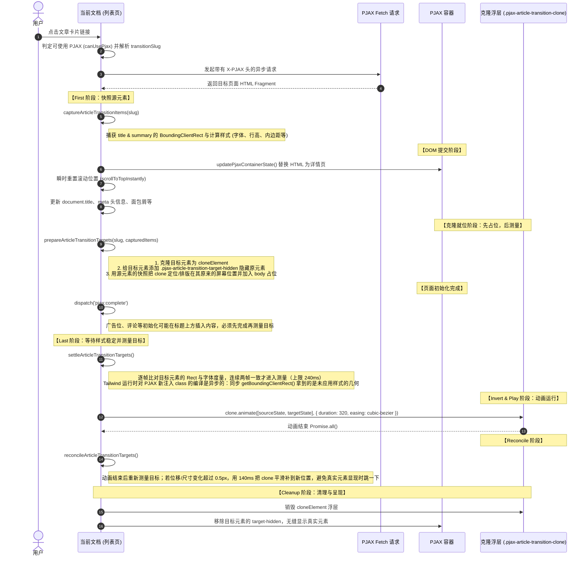

# WindBlog PJAX 与文章进入过渡动画机制指南

WindBlog 采用自研轻量级 PJAX 结合原生 Web Animations API (WAAPI) 实现顺滑的无刷新页面切换，并在**列表/卡片跳转到文章详情页**（以及从详情页返回）时应用了基于 **FLIP 原则的共享元素（Shared Element）过渡动画**。

---

## 1. 核心架构与设计思想

1. **为什么不用原生 View Transitions API？**
   在代码注记与实践中，原生 View Transition 在涉及不同版面排版时，其快照（screenshots）在跨布局文本缩放（字体大小、行高、文字折行）重绘表现上不够平滑（易失真或裁切）。因此 WindBlog 采用了 **手动 FLIP (First, Last, Invert, Play) 动画机制**，精准对文章标题 (`title`) 与摘要 (`summary`) 的尺寸、绝对视口位置及排版样式进行平滑插值。

2. **渐进增强与降级保障：**
   - 若命中系统偏好 `prefers-reduced-motion: reduce`，动画自动跳过。
   - 若目标页没有对应的 transition slug 或目标元素丢失，自动平滑回退到 PJAX 整体容器淡入动画（`opacity: 0.65 -> 1`，耗时 180ms）。
   - 动画逻辑封装在 `try...catch` 中，**动画异常永远不会中断主流程的 PJAX DOM 渲染与路由切换**。

---

## 2. 动画触发与匹配机制

### 2.1 HTML 标记规范 (Qute 模板)
在模板中，文章卡片与文章详情页通过特定的 `data-*` 属性进行配对：
- `data-article-transition-slug="{post.slug}"`：标识目标文章唯一 slug。
- `data-article-transition-card="{post.slug}"`：标识文章列表卡片与文章背景卡片（实现进入与退出时的卡片形状/尺寸/圆角平滑形变）。
- `data-article-transition-part="meta"`：标识文章卡片与详情页上方的作者、发布时间元信息行。
- `data-article-transition-part="cover"`：标识文章封面缩略图/详情页标题下方渐变封面条（`.post-list-cover` <-> `.post-header-cover`）。
- `data-article-transition-part="title"`：标识文章标题部分。
- `data-article-transition-part="summary"`：标识文章 AI 摘要卡片外层容器（可选）。

**代码位置：**
- 列表/分类/标签/搜索模板：
  - `src/main/resources/templates/blog/index.content.html`
  - `src/main/resources/templates/blog/category.content.html`
  - `src/main/resources/templates/blog/tag.content.html`
  - `src/main/resources/templates/blog/search.content.html`
- 文章详情模板：
  - `src/main/resources/templates/blog/post.content.html`
  - `src/main/resources/templates/blog/post.vditor.content.html`

### 2.2 Slug 解析 (`resolveArticleTransitionSlug`)
在点击链接时，根据来源与目标解析 slug：
1. 目标是文章页（`isArticleDetailUrl(url)`）：读取点击锚点所在的 `closest('[data-article-transition-slug]')`。
2. 历史前进/后退：从 `history.state.articleTransitionSlug` 或当前页面文章 `<h1>` 标签读取。
3. 检查来源页 DOM 中是否存在对应的过渡元素：`hasArticleTransitionSource(document, slug)`。

---

## 3. FLIP 动画完整执行时序

执行链路主要位于 `src/main/resources/META-INF/resources/assets/js/main.js` 中的 `loadByPjax` 函数：

---

## 4. 关键实现细节与样式管理

### 4.1 部件化高性能动画策略
为消除逐帧修改 `fontSize`/`lineHeight`/`fontWeight` 引发的 CPU 文本重排（Layout Thrashing）、文字中途折行跳变与字重突变，WindBlog 按部件类型采用针对性的 GPU 加速合成策略：
- **作者与发布时间元信息 (`meta`, `.pjax-article-transition-clone-meta`)**：列表卡片顶部的元信息行与文章详情页标题上方元信息行配对，保证进入与退出时卡片内部元素自上而下顺序（Meta -> Title & Cover -> Summary）完全对称平滑展开与收缩，避免元素交错位移。
- **标题 (`title`, `.pjax-article-transition-clone-title`)**：在测量完目标 `targetStyle` 后将克隆体直接锁定为目标字号、字重与宽度，通过 `transform: translate3d(x, y, 0) scale(sourceFontPx / targetFontPx)` 到 `translate3d(targetX, targetY, 0) scale(1)` 以及 `color` 进行纯 GPU 合成插值。
- **封面 (`cover`, `.pjax-article-transition-clone-cover`)**：列表页左侧缩略图 `.post-list-cover` 与文章详情页标题下方紧凑封面区域 `.post-header-cover` 配对，同步过渡 `transform`、`width`、`height`、`borderRadius`，并同步插值内部图片透明度与 `.post-header-cover-gradient` 遮罩透明度（`0 <-> 1`），确保详情页标题在亮/暗主题下均清晰可读。
- **摘要卡片 (`summary`, `.pjax-article-transition-clone-summary`)**：作用于整个 AI 摘要卡片容器（`overflow: hidden`），平滑插值 `transform`、`width`、`height` 与圆角，避免目标页在动画开始时露出空心边框。
- **过渡层平滑溶解交接 (`revealArticleTransitionTargets` + `fadeOutAndRemoveTransitionClones`)**：动画与位移对齐完成后，先行无缝显示真实 DOM 目标元素，再通过 120ms `ease-out` WAAPI 透明度淡出浮层与背景克隆体，彻底消除过渡层在最后一帧硬切消失（“直接消失”）产生的视觉突兀感。
- **卡片背景共享元素 (`.pjax-article-transition-backdrop` <-> `.pjax-article-transition-target-card`)**：
  - 进入文章时：捕获列表卡片的视口边界与真实计算样式（背景色、圆角、边框、阴影），作为实心卡片克隆体（`z-index: 30`，位于 `#pjax-container` 的 `z-index: 35` 之后）以 `380ms` 平滑形变展开为文章页背景卡片的完整尺寸与圆角；目标卡片在过渡期间通过 `.pjax-article-transition-target-card` 隐藏背景边框以消除双层重影，卡片内部文章正文内容随容器平滑淡入呈现。
  - 关闭/返回列表时：捕获文章背景卡片当前可见视口边界，向列表卡片目标位置反向平滑收缩还原，保持实心背景色彩并过渡圆角和阴影，同时联动封面、元信息、标题与摘要缩小，在动画结束瞬间通过 `style.transition = 'none'` 无闪烁交接给真实目标卡片，消除背景消失与跳变。

### 4.2 动效参数与 CSS 配合
- **时长**：`380ms`（共享元素形变主时长）+ `120ms`（过渡层优雅淡出交接）
- **缓动曲线**：`cubic-bezier(0.22, 1, 0.36, 1)`
- **CSS 类定义** (`src/main/resources/META-INF/resources/assets/css/ui.css` 与 `theme.css`)：
  - `#pjax-container` (`position: relative; z-index: 35`)
  - 面包屑导航 (`position: relative; z-index: 40`，位于卡片外部且高于过渡层)
  - `.pjax-article-transition-backdrop` (`z-index: 30`)
  - `.pjax-article-transition-clone-cover` (`z-index: 9998`, `overflow: hidden`)
  - `.pjax-article-transition-clone-summary` (`z-index: 9999`, `overflow: hidden`)
  - `.pjax-article-transition-clone-meta` (`z-index: 10000`, `overflow: hidden`)
  - `.pjax-article-transition-clone-title` (`z-index: 10001`)
  - `.post-title-stage` / `.post-header-cover` / `.post-header-cover-gradient`：详情页标题下方紧凑封面条与 `--card-bg` 多向透明度渐变遮罩。

### 4.3 滚动与回退位置处理
- 从列表页进入文章页时：
  1. 记录列表页当前滚动位置（`windblogScroll`）存入 `history.state`。
  2. 记住列表来源 URL（`windblog:last-article-list-url`），用于文章详情页的“返回”按钮。
  3. 执行 `instantScroll: true` 立即重置视口到顶部，**确保新页面测量目标元素的 `getBoundingClientRect()` 是静止且准确的**，避免测量期间视口发生滚动抖动。

### 4.4 异步样式与布局稳定（首次进入/退出的错位来源）
Tailwind 在本项目中是**运行时**加载的（`assets/vendor/tailwind/tailwind-cdn.min.js`），它通过 `MutationObserver` 扫描 `[class]` 并在**后续任务**中编译新出现的 class。PJAX 注入的 fragment 里往往包含当前文档从未出现过的 class（尤其是首次从列表进入文章页、或直接打开文章页后首次返回列表），因此：

- 在 `updatePjaxContainerState()` 之后**同步**调用 `getBoundingClientRect()` 会拿到未应用样式的几何。实测文章标题会从 `24px/40px`（默认 h1）变成 `60px/180px`，克隆会停在错误位置，真实元素随后“跳”到正确位置，表现为文字错位。
- 修复方式：先把克隆**停在源位置**（不测量目标），再执行 `settleArticleTransitionTargets()`：
  - 逐帧读取目标元素的 rect 与 `fontSize/lineHeight/fontWeight/letterSpacing`；
  - 连续两帧签名一致才认为布局已稳定（签名数值取 1 位小数，消除 rect 与容器 transform 相减产生的亚像素抖动）；
  - 最长等待 240ms，避免样式缺失时导航卡住；
  - 测量时必须扣掉 `#pjax-container` 入场动画（`translateY(6px)`）的当前位移（`getArticleTransitionContainerOffset`），否则目标坐标会带上动画中的偏移。
- `pjax:complete` 会在动画开始前派发，让广告位等“标题上方”的初始化内容先就位，再锁定目标坐标。
- 动画结束后 `reconcileArticleTransitionTargets()` 会再测一次；若目标仍有超过 0.5px 的位移，用 140ms 把克隆平滑补位后再显示真实元素（惰性图片、晚到的布局初始化等兜底）。

---

## 5. 开发与扩展维护 Checklist

若要在新的视图或新组件中支持此动画，遵循以下步骤：

1. **模板规范**：
   - 卡片容器加上 `data-article-transition-slug="{post.slug}"`。
   - 标题元素加上 `data-article-transition-slug="{post.slug}" data-article-transition-part="title"`。
   - 若有摘要，加上 `data-article-transition-slug="{post.slug}" data-article-transition-part="summary"`。
   - 目标页对应的 `h1` 和摘要块必须有相同的 `slug` 和 `part`。

2. **注意点**：
   - **不要在 DOM 替换后的同步任务里测量目标元素**：Tailwind 运行时的 class 编译是异步的，必须先经过 `settleArticleTransitionTargets()`（详见 4.4）。
   - 保证目标元素是可见的（`rect.width > 0 && rect.height > 0`），否则会自动取消过渡并降级。
   - 避免在克隆元素或过渡元素上使用高开销的复杂嵌套 shadow DOM 或即时计算的动态伪类，因为快照仅抓取 CSS 计算样式。
   - PJAX 加载错误或请求被中途中断（`AbortController`）时，确保 `cleanupArticleTransitionItems` 被调用，防止残留 `visibility: hidden`。
